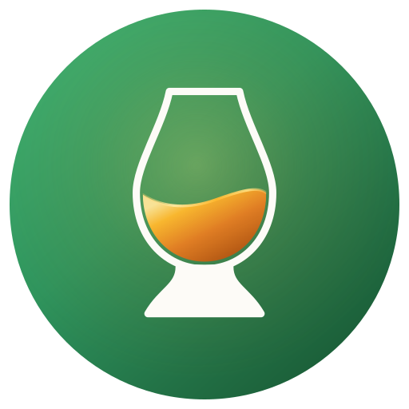

# Aqua Vitaeum

### The Connoisseur’s Digital Codex & Sensory Sanctuary for Fine Spirits.

**A private, local-first tasting companion with AI bottle scanning, 9-axis sensory radar, and interactive aroma wheels.**

 

**[Features](#-key-features) · [Privacy](#%EF%B8%8F-privacy--data-sovereignty) · [Documentation](#-documentation) · [License](#-license)**

---

## What is Aqua Vitaeum?

*Aqua Vitae* (*"Water of Life"*) is the historic Latin name for distilled spirits. Whether it is a heavily peated Islay single malt, a craft bourbon, or a rare single-cask rum, every bottle holds its own sensory narrative.

**Aqua Vitaeum** is a modern, privacy-focused digital tasting journal designed for spirits enthusiasts and collectors. Instead of losing memories in paper notebooks or photo galleries, Aqua Vitaeum provides a structured, aesthetic sanctuary to document collections, visualize aroma complexities, and analyze bottles using client-side AI.

---

## ✨ Key Features

- **📖 Thematic Journals & Hardcover Bookshelf**  
  Organize your collection into bespoke compendiums by region, distillery, or spirit type. Switch seamlessly between Open Manuscript and 3D Hardcover Bookshelf views.
- **🕸️ Grand Sensory Profiling Suite**  
  Map out what you smell and taste using the canonical 9-dimension SWRI taxonomy (*Peaty, Fruity, Floral, Spicy, Cereal, Woody, Winey, Chocolate, Feinty/Sulphury/Nutty*). Seamlessly switch between the **9-Axis Astrolabe Radar Chart** with 0-value hub ring and the interactive **Sunburst Aroma Wheel**.
- **📷 AI Bottle Assistant & Photo Scanner**  
  Capture label photos or scan barcodes. Powered by Google Gemini Flash via client-side BYOK (*Bring Your Own Key*), the assistant automatically suggests distillery names, regions, ABV, cask finishes, and flavor tags.
- **📱 Native OS Gesture Navigation & PWA**  
  Full support for Google Pixel (Android) and iOS native edge-swipe back navigation with hierarchical breadcrumbs. Installs as a standalone PWA with 100% offline functionality.
- **🌙 Irish Pub Aesthetic & Moonlit Dark Mode**  
  Warm chamois parchment (`#F5EFE1`), rich Irish wood green (`#237347`), and amber pot-still copper (`#C97A1E`), calibrated to WCAG 2.2 AAA contrast standards (14.2:1) with zero-latency dark-mode switching.
- **🛡️ Local-First & Zero-Knowledge Sync**  
  All notes, ratings, and photos live securely in client-side IndexedDB. Optional zero-knowledge Google Drive backup keeps devices synchronized without third-party tracking.

---

## 🛡️ Privacy & Data Sovereignty

1. **Zero Tracking**: No Google Analytics, telemetry, cookies, or remote server endpoints.
2. **Local Storage Only**: Your notes and photos remain in your device's browser database (IndexedDB).
3. **Client-Side AI (BYOK)**: Your Google Gemini API key is stored securely in local storage and communicates directly with Google's API over encrypted HTTPS.
4. **Least-Privilege Cloud Sync**: Google Drive synchronization strictly requests `drive.file` scope—it only accesses files created by Aqua Vitaeum itself.

---

## 📚 Documentation

Detailed technical documents, design guidelines, and architecture specifications:

- [Technical Documentation](docs/DOCUMENTATION.md) — Comprehensive feature breakdown and test guides.
- [Design System](docs/DESIGN_SYSTEM.md) — Irish pub aesthetic, CSS custom tokens, and button archetypes.
- [Architecture Guide](docs/ARCHITECTURE.md) — Layer boundaries, Dexie schemas, and sync engine.
- [Agent Directives](AGENTS.md) — 7-Agent engineering standards and audit protocol.

---

## 📄 License

Copyright © 2026 Aqua Vitaeum. All Rights Reserved.  
This software and its source code are proprietary. See [LICENSE](LICENSE) for terms.

 

  Aqua Vitaeum · The Master Distiller’s Digital Codex & Sensory Sanctuary

